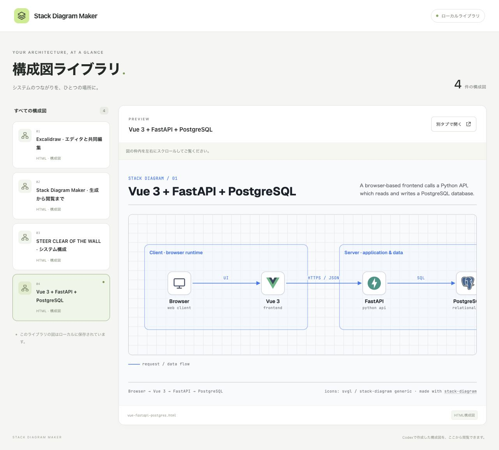
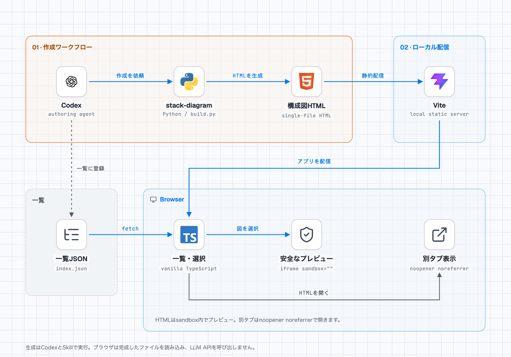

<div align="center">


# Stack Diagram Maker

**構成図をつくる。ためる。見渡す。**

CodexのSkillで生成したHTML構成図を、ひとつのライブラリへ。<br />
一覧から選んでプレビューし、必要なときは別タブで大きく表示できます。

[Quick start](#quick-start) · [Gallery](#gallery) · [How it works](#how-it-works) · [Add a diagram](#add-a-diagram) · [Development](#development)

</div>

---

## Preview



| Browse | Preview | Open |
| --- | --- | --- |
| 構成図を一覧にまとめ、クリックで切り替え。 | sandbox付きiframeで、その場で確認。 | 自己完結HTMLを別タブで広く表示。 |

ロゴとフォントを埋め込んだ構成図は、HTMLファイル単体でも閲覧できます。画面はデスクトップとスマートフォン幅に対応し、空の一覧・読み込みエラー・再試行も扱います。

## Quick start

**Node.jsを用意して、3ステップで起動。** 対応範囲は22.12以降の22系、24系、26以降です。

```sh
git clone https://github.com/taku0193/stack-diagram-maker.git
cd stack-diagram-maker
npm ci
npm run dev
```

ブラウザで **[localhost:5174](http://localhost:5174/)** を開いてください。収録済みの4つの構成図を閲覧できます。

| やりたいこと | 必要なもの |
| --- | --- |
| ライブラリで図を見る | Node.js / npm / ブラウザ |
| 同梱の図を再生成する | 上記に加えてPython 3.9以降 |
| 新しい図を作る | Codex / プロジェクト内の `stack-diagram` Skill |

<details>
<summary>ポートを変更する・本番ビルドを確認する</summary>

5174番が使用中の場合は、別のポートを指定できます。

```sh
npm run dev -- --host 127.0.0.1 --port 5175
```

この場合は [127.0.0.1:5175](http://127.0.0.1:5175/) を開きます。

本番ビルドのローカル確認:

```sh
npm run build
npm run preview
```

プレビューURLは [localhost:4174](http://localhost:4174/) です。

</details>

## Gallery

**シンプルなWeb構成から、公開リポジトリの内部構造まで。** 各タイトルから生成手順や調査の根拠を確認できます。

| 構成図 | 見えること | 再生成 |
| --- | --- | --- |
| [**Excalidraw**](diagrams/excalidraw/README.md) | React・Canvas・ブラウザ保存と、暗号化された共同編集の経路。 | `npm run diagram:build:excalidraw` |
| [**Stack Diagram Maker**](diagrams/stack-diagram-maker/README.md) | このアプリ自身の、Codexによる生成からブラウザ表示まで。 | `npm run diagram:build:self` |
| [**STEER CLEAR OF THE WALL**](diagrams/steer-clear-of-the-wall/README.md) | カメラ・姿勢検出・ゲーム処理・Fitbit心拍・ランキング保存。 | `npm run diagram:build:steer` |
| [**Vue 3 + FastAPI + PostgreSQL**](diagrams/README.md) | Browser → Vue 3 → FastAPI → PostgreSQLの基本構成。 | `npm run diagram:build` |

図は公式Skillのテンプレート・取得スクリプト・ビルド手順で生成しています。公開リポジトリを題材にした図には、参照コミットとソースファイルを記録しています。

## How it works

<picture>
  <source media="(prefers-color-scheme: dark)" srcset="docs/images/workflow-dark.png" />
  
</picture>

1. **Generate** — Codexがプロジェクト内のSkillを使って構成図を生成。
2. **Register** — HTMLを保存し、静的な一覧JSONへ追加。
3. **Browse** — TypeScriptの画面で一覧を読み込み、選択した図を表示。

ブラウザからLLM APIを呼び出す処理はありません。構成図の生成はCodex側で行います。同梱の図は、取得済み画像とフォントを使ってネットワークなしで再生成できます。

## Add a diagram

### 1. CodexとSkillで生成する

`.agents/skills/stack-diagram/` の手順で自己完結HTMLを生成し、`public/diagrams/` に保存します。

### 2. 一覧へ登録する

`public/diagrams/index.json` の**既存の配列に1件追加**します。

```json
{
  "id": "my-architecture",
  "title": "My Architecture",
  "filename": "my-architecture.html"
}
```

### 3. ページを再読み込みする

ライブラリで図を選択し、プレビューと別タブ表示を確認してください。

<details>
<summary>登録データのルール</summary>

| フィールド | ルール |
| --- | --- |
| `id` | 先頭が英数字、その後は英数字・`-`・`_`。一覧内で一意。 |
| `title` | 空でない文字列。 |
| `filename` | 同じ文字種からなる、単一の `.html` ファイル名。 |

外部URL、絶対パス、ディレクトリ、`../`、エンコードされたパス、クエリ、フラグメントは拒否します。

</details>

## Development

Vite + vanilla TypeScript + Vitest。アプリ用のバックエンドやデータベースは不要です。

| コマンド | 内容 |
| --- | --- |
| `npm run dev` | ローカル開発サーバー |
| `npm test` | マニフェスト検証・選択・画面の振る舞いをテスト |
| `npm run build` | TypeScript型検査 + 本番ビルド |
| `npm run preview` | 本番ビルドのローカルプレビュー |
| `npm audit` | 依存関係の脆弱性を確認 |

テストは、不正なファイル名・重複ID・安全なリンク・HTMLを含むタイトル・空状態・エラー・再試行などを対象にしています。実行結果と目視確認の記録は [WORK_LOG](docs/WORK_LOG.md) を参照してください。

<details>
<summary>ディレクトリ構成</summary>

```text
.agents/skills/stack-diagram/   公式Skill・テンプレート・スクリプト
public/diagrams/                生成済みHTML・一覧JSON
src/                           ライブラリ画面・データ検証・選択処理
src/__tests__/                 Vitestテスト
diagrams/                      各図の生成元・アイコン・調査の根拠
docs/                          仕様・作業ログ・README用の画像
```

</details>

<details>
<summary>プレビューの設定とMVPの範囲</summary>

プレビューは `sandbox=""` と `referrerpolicy="no-referrer"` を使い、スクリプト・同一オリジンアクセスなどの権限を追加しません。別タブリンクには `noopener noreferrer` を設定しています。同梱の図は、外部リソースとスクリプトを制限するCSP付きです。

表示対象は、このプロジェクトで管理する信頼できる生成済みHTMLだけです。別タブ表示はHTMLを直接開くため、今後追加する図も自己完結ファイルに限定してください。

ブラウザからのAI生成、図の編集・アップロード、認証、データベース、PNG/PDF出力はMVPの対象外です。図中のFastAPIやPostgreSQLなどは描画対象であり、このアプリの依存サービスではありません。

</details>

<details>
<summary>Skillの取得元・ライセンス</summary>

[caru-ini/stack-diagram](https://github.com/caru-ini/stack-diagram) のSkillをプロジェクト内に同梱しています。グローバルへの導入は不要です。

固定コミット、導入手順、MITライセンスとフォントのSIL OFL 1.1については [SKILL_PROVENANCE](docs/SKILL_PROVENANCE.md) を参照してください。各ロゴの出典は各図の `icons/manifest.json` に記録しています。

</details>

---

<div align="center">

**Generate with Codex. Browse locally.**<br />
<sub>[仕様書](docs/MVP_SPEC.md) · [テスト計画](docs/TEST_PLAN.md) · [作業ログ](docs/WORK_LOG.md) · [Skillの取得元](docs/SKILL_PROVENANCE.md)</sub>

</div>
