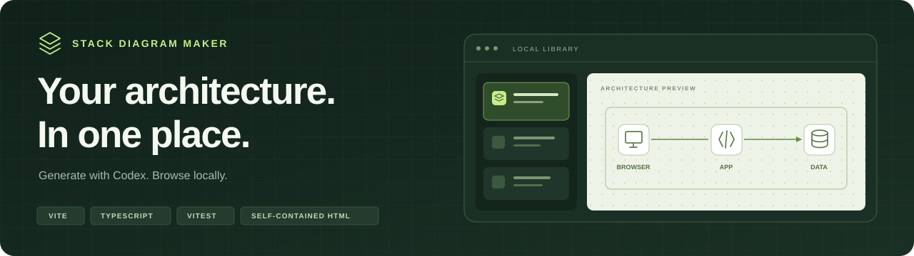

<div align="center">

# 

**Codexで生成したHTML構成図を、ひとつのローカルライブラリに。**

[収録図](#gallery) · [起動する](#quick-start) · [図を追加する](#add-a-diagram) · [開発](#development)

</div>

## Gallery

一覧から図を選んでプレビューし、必要に応じてHTMLを別タブで開けます。各図の解説には、参照ソースと再生成手順を掲載しています。

| 構成図 | 内容 |
| --- | --- |
| [**Excalidraw**](diagrams/excalidraw/README.md) | Canvasエディタ、ブラウザ保存、暗号化された共同編集 |
| [**Stack Diagram Maker**](diagrams/stack-diagram-maker/README.md) | Codexでの図の生成からライブラリでの閲覧まで |
| [**Steer Clear of the Wall**](diagrams/steer-clear-of-the-wall/README.md) | カメラでの姿勢検出、ゲーム処理、心拍、ランキング |
| [**Vue 3 + FastAPI + PostgreSQL**](diagrams/README.md) | ブラウザからAPIとデータベースにつながる基本構成 |

## Quick start

Node.js 22.12以降の22系、24系、または26以降が必要です。

```sh
git clone https://github.com/taku0193/stack-diagram-maker.git
cd stack-diagram-maker
npm ci
npm run dev
```

[localhost:5174](http://localhost:5174/) を開くと、収録済みの図をすぐに閲覧できます。

<details>
<summary>別のポートで起動する</summary>

5174番が使用中の場合は、別のポートを指定します。

```sh
npm run dev -- --host 127.0.0.1 --port 5175
```

この場合は [127.0.0.1:5175](http://127.0.0.1:5175/) を開きます。

</details>

## Add a diagram

1. **生成する** — Codexで同梱の [`stack-diagram` Skill](.agents/skills/stack-diagram/SKILL.md) を使い、自己完結したHTMLを `public/diagrams/` に保存します。
2. **登録する** — [`index.json`](public/diagrams/index.json) の既存の配列に、次の形式で1件追加します。

   ```json
   {
     "id": "my-architecture",
     "title": "My Architecture",
     "filename": "my-architecture.html"
   }
   ```

3. **閲覧する** — ページを再読み込みし、図を選択します。

`id` と拡張子を除いたファイル名は英数字で始め、英数字、`-`、`_` で構成します。`id` は一覧内で一意にし、`title` には表示名を入力します。

<details>
<summary>収録図を再生成する</summary>

Python 3.9以降が必要です。同梱の画像とフォントを使用するため、オフラインで再生成できます。

| 構成図 | コマンド |
| --- | --- |
| Excalidraw | `npm run diagram:build:excalidraw` |
| Stack Diagram Maker | `npm run diagram:build:self` |
| Steer Clear of the Wall | `npm run diagram:build:steer` |
| Vue 3 + FastAPI + PostgreSQL | `npm run diagram:build` |

</details>

## Development

ViteとTypeScriptで動く静的なアプリです。図の生成はCodex側で行い、ブラウザは一覧とHTMLを読み込みます。

```sh
npm test
npm run build
npm run preview
```

本番ビルドのプレビューは [localhost:4174](http://localhost:4174/) で確認できます。

<details>
<summary>ファイル構成とプレビューの仕様</summary>

| パス | 内容 |
| --- | --- |
| [`src/`](src/) | ライブラリ画面、一覧データの検証、選択処理 |
| [`public/diagrams/`](public/diagrams/) | 一覧JSONと、画像・フォントを埋め込んだ生成済みHTML |
| [`diagrams/`](diagrams/) | 各図の生成元、アイコン、調査資料 |
| [`.agents/skills/stack-diagram/`](.agents/skills/stack-diagram/) | 構成図を生成するSkillとそのテンプレート |

プレビューは `sandbox=""` と `referrerpolicy="no-referrer"` を付けたiframeで表示します。別タブのリンクには `noopener noreferrer` を設定しています。マニフェストにはプロジェクト内で管理するHTMLだけを登録してください。

</details>

---

[仕様書](docs/MVP_SPEC.md) · [テスト計画](docs/TEST_PLAN.md) · [作業ログ](docs/WORK_LOG.md) · [Skillの取得元とライセンス](docs/SKILL_PROVENANCE.md)
